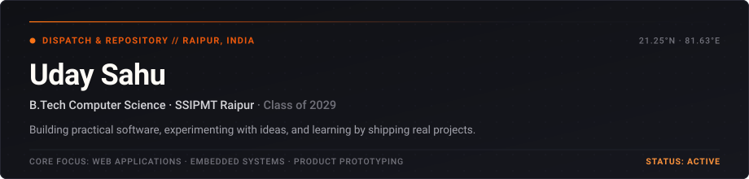

 

[Portfolio ↗](https://udaysahu.tech) &nbsp;·&nbsp; [LinkedIn ↗](https://www.linkedin.com/in/udaysahu29/) &nbsp;·&nbsp; [GitHub ↗](https://github.com/udaysahu-source) &nbsp;·&nbsp; [Email ↗](mailto:udaysahu.in@gmail.com)

> **A developer who builds things, experiments with ideas, and learns by shipping real projects.**

---

### 01 / About

I am a Computer Science undergraduate at **SSIPMT Raipur** (Class of **2029**) focused on software development, product building, and practical problem-solving.

Rather than remaining in passive tutorial loops, I learn by shipping end-to-end applications: identifying everyday friction, crafting intuitive interfaces, structuring relational or document data schemas, and deploying to cloud infrastructure. My work centers on solving tangible problems in campus workflows, student transit, localized city discovery, and peer gaming.

---

### 02 / Selected Projects

#### [BunkD](https://bunk-d.vercel.app/) `Live · PWA`
**Attendance & Margin Calculator** &nbsp;—&nbsp; [Live Application ↗](https://bunk-d.vercel.app/) &nbsp;·&nbsp; [Source Repository ↗](https://github.com/udaysahu-source/bunkd)

Built to eliminate guesswork around mandatory attendance cutoffs. BunkD dynamically models safe lecture skips and projects exact recovery classes required to get back above target thresholds. Engineered as an installable PWA with dual-mode storage: guest offline caching via LocalStorage and authenticated cloud persistence through Firebase.

- **Stack:** `JavaScript` · `Firebase Auth & Firestore` · `LocalStorage` · `PWA` · `Vercel`
- **Highlights:** Deterministic margin forecasting, zero-latency mobile caching, subject-wise threshold tracking

 

#### [KahaJau](https://kahajau.vercel.app) `In Active Development`
**Hyperlocal Venue Discovery Platform** &nbsp;—&nbsp; [Early Build ↗](https://kahajau.vercel.app) &nbsp;·&nbsp; [Source Repository ↗](https://github.com/udaysahu-source/KahaJau)

A venue-discovery platform engineered for students and young people in tier-3 Indian cities, starting in Raipur where new cafes, study spots, and community hangouts open frequently without reliable search visibility. Adapts recommendations dynamically based on the current hour (morning breakfast spots, afternoon study zones, evening chill zones).

- **Stack:** `JavaScript` · `Next.js` · `Node.js` · `Supabase (PostgreSQL & Auth)` · `Vercel`
- **Highlights:** Time-sensitive feed engine ("Now" radar), vibe-based categorization, verified merchant directory

 

#### [Bro or Fraud](https://bro-or-fraud.vercel.app/) `Live`
**Pass-The-Phone Social Deduction Game** &nbsp;—&nbsp; [Play Live ↗](https://bro-or-fraud.vercel.app/) &nbsp;·&nbsp; [Source Repository ↗](https://github.com/udaysahu-source/bro_or_fraud)

An interactive multiplayer deception game designed for college hostels and friends' meetups. Removes all onboarding friction: zero app downloads, no account setup, and runs entirely in a mobile browser on a single shared device through fast-paced timed questioning rounds to expose the secret imposter.

- **Stack:** `React 19` · `TypeScript` · `Tailwind CSS` · `Vercel`
- **Highlights:** Single-device pass-and-play state loop, rapid countdown logic, localized college word decks

 

#### CHECKIN `Hardware Prototype`
**Automated Bus-Pass OCR Verification** &nbsp;—&nbsp; Proof of Concept

An embedded edge-vision system exploring automated transit authorization on college bus routes. An ESP32-CAM module mounted at vehicle entry captures student bus passes and runs localized optical character recognition (OCR) to validate student credentials, cutting boarding bottlenecks without recurring cloud API costs.

- **Stack:** `C++` · `ESP32-CAM` · `Optical Character Recognition` · `Embedded Systems`
- **Highlights:** On-device image acquisition, contrast pre-processing, localized pattern extraction

 

#### [BuildSeek](https://buildseek.vercel.app) `In Development`
**Student Builder & Hackathon Aggregator** &nbsp;—&nbsp; [Live Demo ↗](https://buildseek.vercel.app) &nbsp;·&nbsp; [Source Repository ↗](https://github.com/udaysahu-source/BuildSeek)

A central radar for collegiate developers tracking hackathon deadlines and open-innovation sprints. Aggregates scattered challenge notices from Devpost, Unstop, and community portals into a unified feed with dynamic countdown timers, skill-match relevance scoring, and one-click iCal synchronization.

- **Stack:** `Next.js` · `TypeScript` · `Supabase (PostgreSQL & RLS)` · `Tailwind CSS` · `Vercel`
- **Highlights:** Multi-source ingestion pipeline, RFC 5545 iCal generation, automated deadline urgency states

 

#### [After9](https://after9.vercel.app) `Prototype`
**Navratri Event Matchmaking PWA** &nbsp;—&nbsp; [Live Demo ↗](https://after9.vercel.app) &nbsp;·&nbsp; [Source Repository ↗](https://github.com/udaysahu-source/after9)

A hyperlocal partner-finder tailored for the nine nights of Navratri festival celebrations in Raipur. When two users swipe and connect, the app triggers a synchronized dual-dandiya clash animation complete with custom sound effects and haptic feedback, paired with venue calendars and invitation tokens.

- **Stack:** `TypeScript` · `React` · `Progressive Web App` · `Vercel`
- **Highlights:** Audio-visual match transitions, token-gated invitations, festival schedule directory

---

### 03 / Stack & Capabilities

Only technologies I actively build with and understand through project implementation:

| Layer | Primary Technologies | Practical Application |
| :--- | :--- | :--- |
| **Languages** | `C++` &nbsp;·&nbsp; `TypeScript` &nbsp;·&nbsp; `JavaScript (ES6+)` &nbsp;·&nbsp; `Python` &nbsp;·&nbsp; `HTML5/CSS3` | Algorithmic problem-solving, typed client/server applications, scripting |
| **Frontend** | `React` &nbsp;·&nbsp; `Next.js` &nbsp;·&nbsp; `Tailwind CSS` &nbsp;·&nbsp; `PWA Architecture` &nbsp;·&nbsp; `Vite` | Responsive mobile-first interfaces, client state, offline caching |
| **Backend & Data** | `Node.js` &nbsp;·&nbsp; `PostgreSQL (via Supabase)` &nbsp;·&nbsp; `Firebase (Firestore & Auth)` &nbsp;·&nbsp; `REST APIs` | Relational schemas, authentication flows, row-level security policies |
| **Environment** | `Ubuntu Linux` &nbsp;·&nbsp; `Git & GitHub` &nbsp;·&nbsp; `Vercel` &nbsp;·&nbsp; `Figma` &nbsp;·&nbsp; `VS Code` | Daily terminal workflows, version control, CI/CD, interface drafting |

---

### 04 / Current Exploration

Areas I am actively studying and experimenting with alongside my coursework:

- **Data Structures & Algorithms:** Practicing computational problem-solving patterns on LeetCode and Codeforces.
- **Full-Stack Architecture:** Building with Next.js App Router, server-side caching, and offline-first PWA sync.
- **Relational Modeling & Security:** Structuring PostgreSQL schemas, database normalization, and Row-Level Security (RLS) policies.
- **Systems & Computing Foundations:** Working daily in an Ubuntu Linux environment, exploring operating systems, networking protocols, and cybersecurity basics.

---

### 05 / Activity & Telemetry

&nbsp;

---

### 06 / Connect

- **Portfolio:** [udaysahu.tech](https://udaysahu.tech)
- **LinkedIn:** [linkedin.com/in/udaysahu29](https://www.linkedin.com/in/udaysahu29/)
- **GitHub:** [github.com/udaysahu-source](https://github.com/udaysahu-source)
- **Email:** [udaysahu.in@gmail.com](mailto:udaysahu.in@gmail.com)
